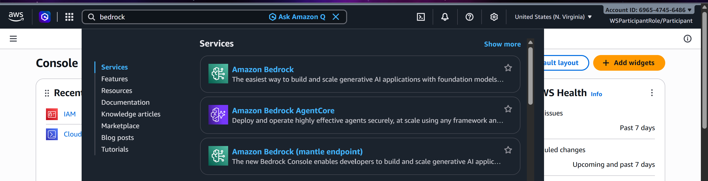
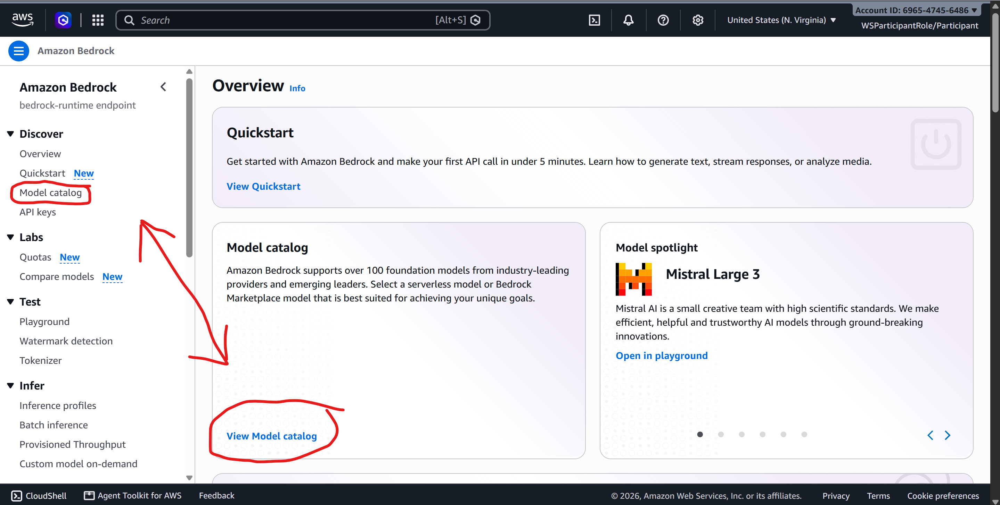

# Calling Amazon Bedrock from Python
> **Santa Clara University ACM - Fall AWS Hackathon**

This guide shows you how to call Amazon Bedrock AI models from Python using the two starter files included in this folder. Before starting, complete the [Setup tutorial](../1-setup/README.md) and make sure you have your AWS credentials ready.

---

## Fundamental Rules
1. **Never Hardcode Credentials**: Do NOT paste your `AWS_ACCESS_KEY_ID` or `AWS_SECRET_ACCESS_KEY` directly in your code — they are loaded from your terminal environment automatically.
2. **Backend Only**: Only call AWS from your backend (Python). Never call AWS directly from a React, iOS, or web frontend.

---

## Table of Contents
- [1) Setting Up Your Python Environment](#1-setting-up-your-python-environment)
- [2) Enabling AWS Bedrock Models](#2-enabling-aws-bedrock-models)
- [3) Using the Python Files](#3-using-the-python-files)
- [4) Common Errors & Troubleshooting](#4-common-errors--troubleshooting)

---

## 1) Setting Up Your Python Environment

First, we need to create a virtual environment for Python, which essentially installs your packages to one project instead of globally. Make sure you have Python downloaded.

Create a virtual environment by running the following in the terminal directory of your project:

**Windows:**
```powershell
py -m venv venv
```

**Mac/Linux:**
```shell
python3 -m venv venv
```

Then, you need to actually use the environment, so type the following:

**Windows:**
```powershell
venv\Scripts\Activate.ps1
```

**Mac/Linux:**
```shell
source ./venv/bin/activate
```

Your terminal should have `(venv)` at the beginning of it now.

> I would recommend setting your VSCode interpreter to the venv path in the bottom right when a Python file is open.

I have made a `requirements.txt` to install all of the packages you will need, so run the following to install them:

```shell
pip install -r requirements.txt
```

Your credentials are already set from the 1-setup tutorial, so you are ready to call AWS services!

---

## 2) Enabling AWS Bedrock Models

If you plan to use Amazon Bedrock in your code, you need to find the model ID for whichever model you want to use.

1. In the search bar, type **Bedrock** and click on the service (it has a green icon)


2. Click on **Model catalog** under the **Discover** section in the left sidebar

    - Browse the available models and explore what fits your use case
    - You can use the **Playgrounds** in the **Test** section to try models interactively and tune values like temperature and top P before writing any code
    - Keep note of settings like temperature and top P as you tune the model — you'll plug these into `inferenceConfig` in your code
3. Once you've found a model you want to use, click on it in the Model catalog and look for an **Inference profile ID** field on the page:
    - **If an Inference profile ID is shown** — copy that and use it as your `model_id`. It will look like `us.meta.llama4-scout-17b-instruct-v1:0` (note the `us.` prefix)
    - **If no Inference profile ID is shown** — copy the **Model ID** directly instead. It will look like `openai.gpt-oss-20b-1:0`

> If you use the plain Model ID for a model that requires an inference profile, you will get a `ValidationException` error that says "Retry your request with the ID or ARN of an inference profile." That means you need to go back and copy the Inference profile ID instead.

---

## 3) Using the Python Files

There are 2 files I have made for you: `bedrock.py` and `converse.py`. Both call Amazon Bedrock with the model you choose to generate a response to a given prompt.

- Change `model_id` to the model you selected in the AWS Console
    - The value depends on whether your model uses a plain Model ID or an Inference Profile ID (see section 2)
- Change `user_message` to the prompt you want to use
- Change the `inferenceConfig` if you want to specify temperature, topP, etc.
- Run the file you changed with the following, with the terminal showing `(venv)`:

```shell
python bedrock.py
```
or
```shell
python converse.py
```

You should see the response in the console!

- `bedrock.py` may take a long time depending on the prompt, as it waits for the entire response to complete
- `converse.py` acts more like ChatGPT, where it generates the response in real-time

---

## 4) Common Errors & Troubleshooting

**`ExpiredTokenException` / `UnrecognizedClientException`**
- **Cause**: Your session credentials have expired or were not set in your terminal
- **Fix**: Re-run the credential script from the 1-setup tutorial, then reopen your terminal

**`AccessDeniedException` / `UnauthorizedOperation`**
- **Cause**: Model access isn't enabled for that model in the Bedrock console, or you're working in the wrong region
- **Fix**: Open the model in the Bedrock console (see [section 2](#2-enabling-aws-bedrock-models)) and check that access is enabled for it. Make sure the console is set to `us-east-1` and your code uses `region_name="us-east-1"`

**`ValidationException` — "Retry your request with the ID or ARN"**
- **Cause**: The model you selected requires an Inference Profile ID, not a plain Model ID
- **Fix**: Go back to the Model catalog, click your model, and copy the Inference Profile ID instead

**`Region` / `Endpoint Missing`**
- **Cause**: The SDK cannot determine which AWS region to use
- **Fix**: Make sure `region_name="us-east-1"` is set in your `boto3.client()` call
